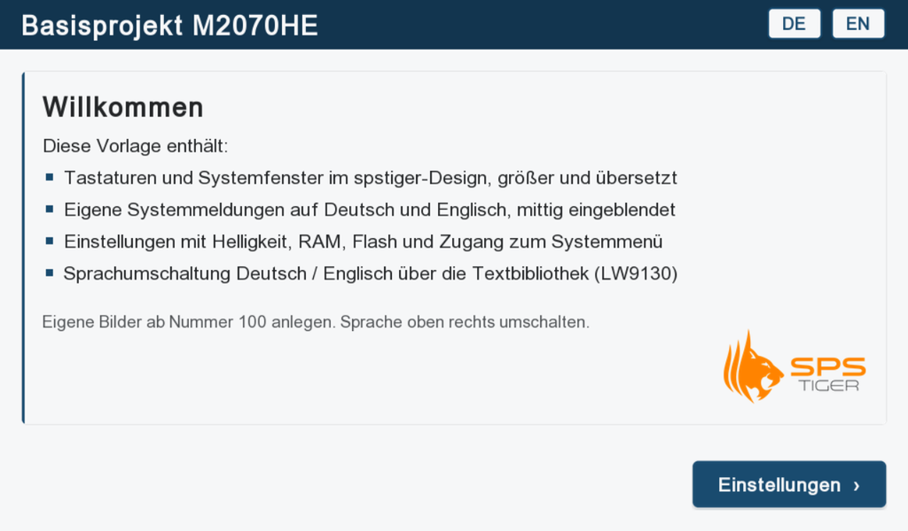
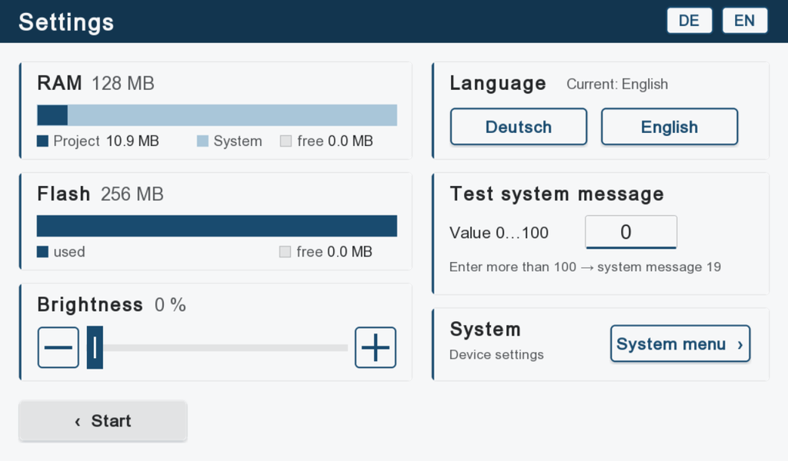
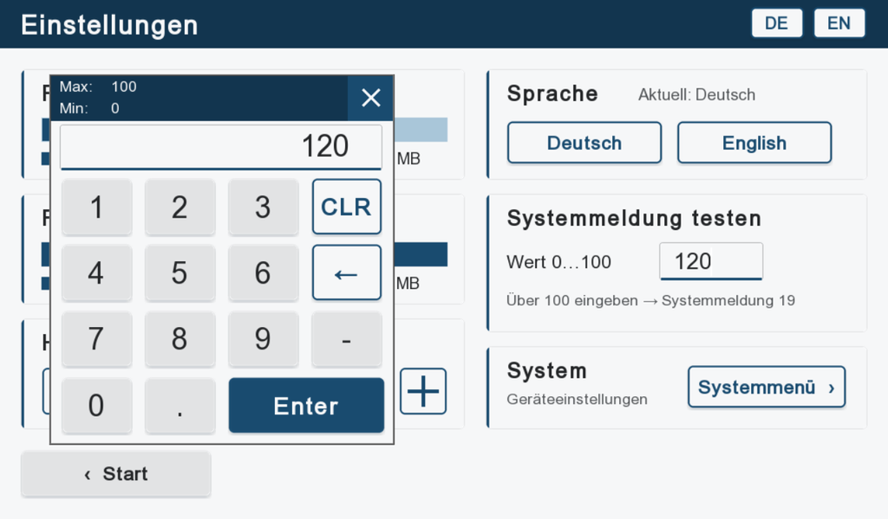
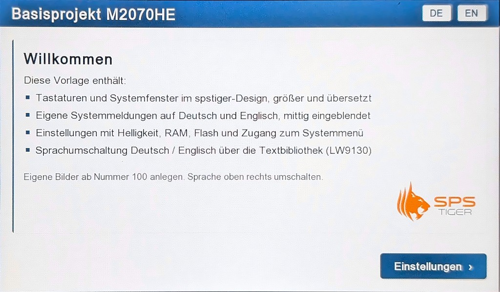
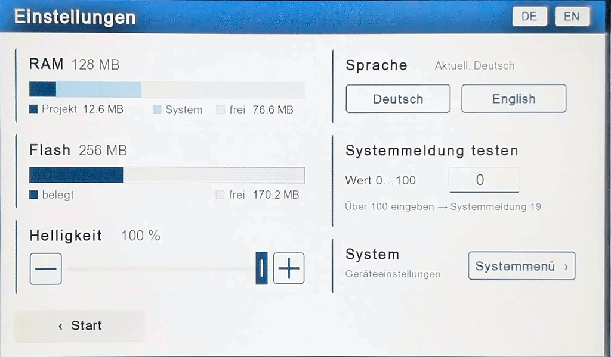

# Kinco DTools Basisprojekt (deutsch)

Kostenlose Vorlage für eure Kinco-HMI-Projekte: deutsche Oberfläche im spstiger-Design, größere
Tastaturen und Systemfenster, eigene Systemmeldungen, Einstellseite und Sprachumschaltung
Deutsch/Englisch. Projekt öffnen, eigene Bilder ab Nummer 100 anlegen, loslegen.

| Einstellungen (Englisch)                                            | Zifferntastatur                                                    |
| ------------------------------------------------------------------- | ------------------------------------------------------------------ |
|  |  |

So sieht es auf einem echten M2070HE aus, mit RAM- und Flash-Werten des Geräts (Fotos entzerrt):

| Startseite | Einstellungen |
| --- | --- |
|  |  |

## Projekte

| Gerät                | Auflösung   | RAM / Flash     | DTools | Ordner                                                                                       |
| -------------------- | ----------- | --------------- | ------ | -------------------------------------------------------------------------------------------- |
| **M2070HE**          | 1024 × 600  | 128 MB / 256 MB | 4.4    | [`M2070HE_DTools4.4`](M2070HE_DTools4.4)                                                     |
| **M2070HE**          | 1024 × 600  | 128 MB / 256 MB | 4.5    | [`M2070HE_DTools4.5`](M2070HE_DTools4.5)                                                     |
| **M2100E**           | 1024 × 600  | 128 MB / 256 MB | 4.4    | [`M2100E_DTools4.4`](M2100E_DTools4.4)                                                       |
| **M2100E**           | 1024 × 600  | 128 MB / 256 MB | 4.5    | [`M2100E_DTools4.5`](M2100E_DTools4.5)                                                       |
| **G100E2-WiFi-PR01** | 1024 × 600  | 256 MB / 256 MB | 4.4    | [`G100E2-WiFi-PR01_DTools4.4`](G100E2-WiFi-PR01_DTools4.4)                                   |
| **G100E2-WiFi-PR01** | 1024 × 600  | 256 MB / 256 MB | 4.5    | [`G100E2-WiFi-PR01_DTools4.5`](G100E2-WiFi-PR01_DTools4.5)                                   |
| **M2043HE**          | 800 × 480   | 128 MB / 256 MB | 4.4    | [`M2043HE_DTools4.4`](M2043HE_DTools4.4) – Einstellungen auf zwei Seiten                     |
| **M2043HE**          | 800 × 480   | 128 MB / 256 MB | 4.5    | [`M2043HE_DTools4.5`](M2043HE_DTools4.5) – Einstellungen auf zwei Seiten                     |
| **MK070E**           | 800 × 480   | 64 MB / 128 MB  | 4.4    | [`MK070E_DTools4.4`](MK070E_DTools4.4) – mit integrierter SPS                                |
| **MK070E**           | 800 × 480   | 64 MB / 128 MB  | 4.5    | [`MK070E_DTools4.5`](MK070E_DTools4.5) – mit integrierter SPS                                |
| **GL043E**           | 480 × 272   | 128 MB / 128 MB | 4.4    | [`GL043E_DTools4.4`](GL043E_DTools4.4) – Einstellungen auf zwei Seiten                       |
| **GL043E**           | 480 × 272   | 128 MB / 128 MB | 4.5    | [`GL043E_DTools4.5`](GL043E_DTools4.5) – Einstellungen auf zwei Seiten                       |
| **MK043E**           | 480 × 272   | 64 MB / 128 MB  | 4.4    | [`MK043E_DTools4.4`](MK043E_DTools4.4) – mit integrierter SPS, Einstellungen auf zwei Seiten |
| **MK043E**           | 480 × 272   | 64 MB / 128 MB  | 4.5    | [`MK043E_DTools4.5`](MK043E_DTools4.5) – mit integrierter SPS, Einstellungen auf zwei Seiten |
| **GT2156E**          | 1920 × 1080 | 512 MB / 4 GB   | 4.4    | [`GT2156E_DTools4.4`](GT2156E_DTools4.4)                                                     |
| **GT2156E**          | 1920 × 1080 | 512 MB / 4 GB   | 4.5    | [`GT2156E_DTools4.5`](GT2156E_DTools4.5)                                                     |

Gestaltet ist alles für 1024 × 600. Auf anderen Displays ist die Oberfläche als Ganzes skaliert:

| Auflösung                            | Bilder | Komponenten | Systemfenster |
| ------------------------------------ | ------ | ----------- | ------------- |
| 1024 × 600                           | 1      | L           | 1             |
| 800 × 480 (7 Zoll, MK070E)           | 0,75   | M           | 1             |
| 800 × 480 (4,3 Zoll, M2043HE)        | 0,83   | M           | 1             |
| 480 × 272 (4,3 Zoll, GL043E, MK043E) | 0,5    | S           | 0,6           |
| 1920 × 1080                          | 1,75   | XL          | 1,75          |

Auf den 4,3-Zoll-Geräten GL043E, MK043E und M2043HE sind Tasten und Schrift so groß, dass man sie mit dem Finger
gut trifft. Dafür stehen die Einstellungen dort auf zwei Seiten.

Ein Projekt für 4.4 lässt sich auch in DTools 4.5 öffnen: DTools fragt, ob es konvertiert werden soll.
Danach öffnet es sich nicht mehr in 4.4.

## Was drin ist

**Bild 0 „Start“** – Überblick über die Vorlage, Sprachumschaltung oben rechts, Taste „Einstellungen“.

**Bild 10 „Einstellungen“**

| Bereich              | Funktion                                                     | Register       |
| -------------------- | ------------------------------------------------------------ | -------------- |
| RAM                  | Belegung Projekt / System / frei, Variante passend zum Gerät | LW9136, LW9134 |
| Flash                | belegt / frei, Variante passend zum Gerät                    | LW9036         |
| Helligkeit           | − / Regler / +, Anzeige in %                                 | LW9140 (0–32)  |
| Sprache              | Deutsch / English, aktuelle Sprache                          | LW9130         |
| Systemmeldung testen | Eingabe 0…100, darüber erscheint Systemmeldung 19            | LW8110         |
| System               | Systemmenü des HMI öffnen, mit Bestätigungsabfrage           | LB9404         |

RAM, Flash und Helligkeit stammen aus den
[kostenlosen spstiger-Komponenten](https://github.com/spstiger/Kinco-HMI-DTools-free-spstiger-components)
(ab Version 2.1). Bei GL043E, MK043E und M2043HE ist die Seite zweigeteilt: RAM, Flash und Helligkeit auf Bild 10
„Einstellungen 1/2“, Sprache, Systemmeldung und System auf Bild 11 „Einstellungen 2/2“.

**Systemfenster** – Zifferntastatur, Hex- und Texttastatur (QWERTZ), Anmeldung mit Benutzerauswahl
und Ebenen-PIN, Bestätigung, Passwort, Dateiliste, Durchreichen und Projekt-Import: größer, im
spstiger-Design, alle Texte übersetzt.

**Eigene Systemmeldungen (Bild 40)** – statt der kleinen Kinco-Meldung erscheint ein eigenes Fenster
mittig auf dem Bildschirm, auf Deutsch oder Englisch:

| Nr. | Meldung                     |
| --- | --------------------------- |
| 13  | Benutzer ist gesperrt.      |
| 19  | Wert außerhalb von Min/Max. |
| 24  | Passwort falsch.            |
| 29  | Keine Berechtigung.         |
| 34  | Benutzername ungültig.      |
| 35  | Vorgang ausgeführt.         |

Die Kinco-Box für diese Nummern ist über LB9245 und die Maske LW9296–LW9299 abgeschaltet, das Fenster
hängt an den Anzeige-Bits LW9550 ff. Alle anderen Meldungen zeigt Kinco wie gewohnt.

## Sprachen

Alle Texte stehen in der **Textbibliothek** von DTools (Sprache 1 = Deutsch, Sprache 2 = Englisch),
umgeschaltet wird über **LW9130** (0 = Deutsch, 1 = Englisch). Für eine weitere Sprache in DTools die
Anzahl der Sprachen erhöhen und in der Textbibliothek die neue Spalte ausfüllen. Tastenbeschriftungen
wie Enter, CLR oder ABC sind in allen Sprachen gleich und bleiben feste Texte.

## Vor dem Einsatz anpassen

> **Passwörter ändern.** Das Projekt nutzt die Kinco-Werksvorgaben: Upload, Dekompilieren, die drei
> Ebenen-Passwörter, Download, FTP sowie Bedienung/Überwachung **888888**, Passwortknoten **123456**.
> Diese Werte sind öffentlich bekannt – vor dem Einsatz an einer Maschine in DTools eigene setzen
> (HMI-Eigenschaften).

- **SPS-Verbindung:** In den 4.4-Projekten für M2070HE, M2100E und G100E2 steht als Platzhalter eine
  Siemens S7-1200, ihre 4.5-Projekte sind ohne SPS angelegt. MK070E und MK043E sind in beiden Versionen
  mit ihrer integrierten SPS angelegt, GL043E, M2043HE und GT2156E ohne SPS. Unter Projektdaten eure SPS eintragen bzw. den
  Platzhalter löschen. Die Bilder der Vorlage nutzen nur
  HMI-interne Register und funktionieren ohne SPS.
- **Gerät:** Für ein anderes Kinco-HMI das Projekt mit derselben Auflösung nehmen und den HMI-Typ in
  DTools umstellen. Speicheranzeigen passend zur RAM-/Flash-Größe des Geräts aus der
  Komponenten-Bibliothek neu einfügen.
- **Eigene Bilder** ab Nummer 100 anlegen. 0 und 10 (GL043E, MK043E und M2043HE auch 11) sind die Vorlage, 40 die
  Systemmeldung, 1–9, 32766 und 32767 die Systemfenster.
- **Eigene Register** nicht ab LB/LW 8900 anlegen – dieser Bereich ist für Systemregister reserviert.
  Die Vorlage selbst nutzt LW8110 (Testwert).

## Projekt öffnen

1. [Kinco DTools](https://www.spstiger.de/moorl-dc-v2/85089e4d00614b9fb80f0dfebf415ee0/read?path=Kinco%20DTools/Kinco%20DTools%20V4.4.0.3_Build250508_250613.zip)
   ab Version 4.4 installieren.
2. Dieses Repository als ZIP herunterladen oder klonen, z. B. mit GitHub Desktop.
3. Die `.dpj`-Datei im Ordner des Geräts in DTools öffnen.
4. Im Menü **Werkzeuge** kompilieren, dann **Offline-Simulation** oder **Download auf das HMI**.

> Tipp: Vor jeder Offline-Simulation einmal kompilieren. Ohne frisches Kompilieren zeigt die Simulation
> unter Umständen noch das zuletzt geöffnete Projekt.

## Hinweise für Git

- Schon beim Öffnen schreibt DTools die `.dpj` neu. Nur angesehen oder simuliert → Änderungen in
  GitHub Desktop verwerfen. Bewusst geändert → alle geänderten Projektdateien zusammen committen.
- Die `.gitignore` hält alles fern, was DTools selbst erzeugt (`temp/`, `tar/`, `.pkgx`, `.bak`,
  `PLCGEDefaultProperties.xml` …).

## Mehr zu Kinco-HMIs

- [Kostenlose DTools-Komponenten von spstiger](https://github.com/spstiger/Kinco-HMI-DTools-free-spstiger-components)
- [Projektvorlage für eigene Repositories](https://github.com/spstiger/KincoDToolsTemplate)
- Kinco-HMIs, Software und Support: [spstiger.de](https://www.spstiger.de)

## Lizenz

[MIT](LICENSE) – frei nutzbar, auch in kommerziellen Projekten, ohne Gewähr.
